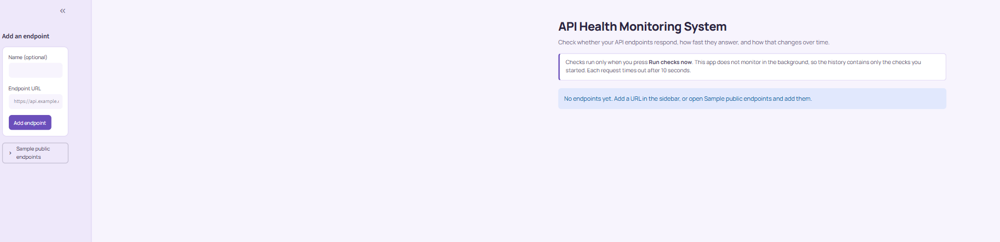
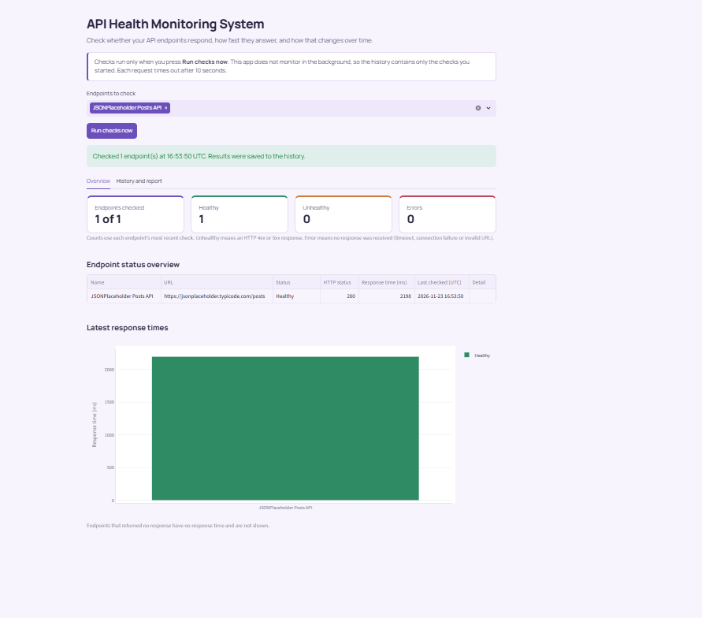
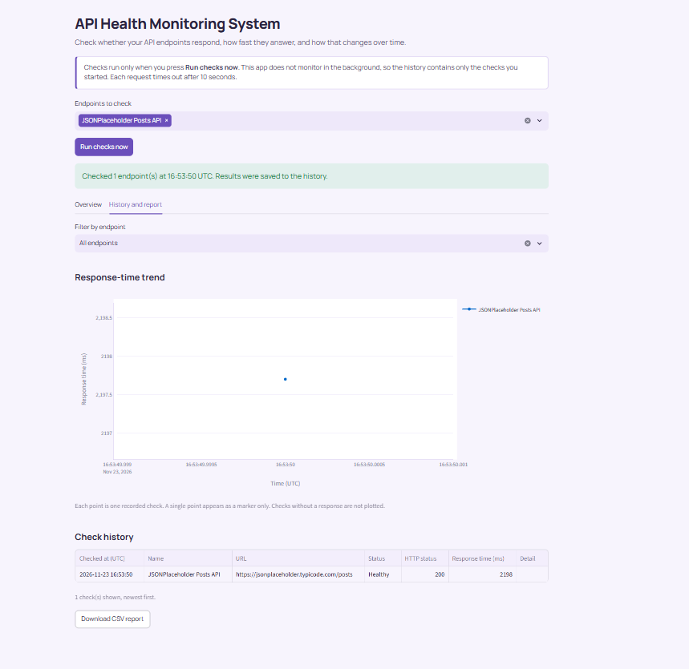

# API Health Monitoring System

A Python-based API Health Monitoring System with a Streamlit dashboard. It checks whether API endpoints are reachable, measures their response times, tracks their status, and stores monitoring history in a local SQLite database.

**Important:** Checks run only when you click **Run checks now**. The application does not perform background monitoring.

## Features

- Add and remove API endpoints.
- Validate URLs before sending requests.
- Check API availability using HTTP GET requests.
- Measure API response time in milliseconds.
- Display HTTP status codes and health status.
- Classify endpoints as Healthy, Unhealthy, or Error.
- Display dashboard statistics and response-time charts.
- Store monitoring history using SQLite.
- View historical monitoring results.
- Filter monitoring history by endpoint.
- Download monitoring reports as CSV files.
- Use a 10-second request timeout.

## Technologies Used

- Python
- Streamlit
- Requests
- SQLite
- Pandas
- Plotly
- Pytest

## Project Structure

```text
api-health-monitoring-system/
│
├── .streamlit/
│   └── config.toml
│
├── tests/
│   └── test_api_monitor.py
│
├── Screenshots/
│   ├── dashboard.png
│   ├── api-analysis.png
│   └── monitoring-results.png
│
├── .gitignore
├── README.md
├── api_monitor.py
├── app.py
├── database.py
└── requirements.txt
```

The `monitoring.db` database is created automatically when the application runs. It is intended to remain local and is excluded from Git.

## Installation

Clone the repository:

```bash
git clone https://github.com/Sara-png-ops/api-health-monitoring-system.git
```

Move into the project directory:

```bash
cd api-health-monitoring-system
```

Install the required dependencies:

```bash
python -m pip install -r requirements.txt
```

## Running the Application

Run the following command:

```bash
python -m streamlit run app.py
```

Open the local URL displayed in your terminal, usually:

```text
http://localhost:8501
```

### How to Use

1. Open the application.
2. Add an API endpoint using its name and URL.
3. Click **Add Endpoint**.
4. Click **Run checks now** to test the endpoint.
5. Review the endpoint status and response time.
6. Open the history section to view previous checks.
7. Download the monitoring report as a CSV file.

## Screenshots

### Dashboard Overview



### API Analysis



### Monitoring Results



## Running Tests

Run the following command:

```bash
python -m pytest -v
```

The tests check the API monitoring functionality, including URL validation and HTTP response handling.

## How Results Are Classified

| Status | Meaning |
|---|---|
| Healthy | API returns an HTTP status code between 200 and 399. |
| Unhealthy | API returns an HTTP status code between 400 and 599. |
| Error | Request fails because of a timeout, connection issue, DNS problem, or other request error. |

## Security Considerations

- URLs are validated before requests are sent.
- URLs containing credentials or sensitive query parameters are rejected.
- Requests use a 10-second timeout.
- CSV reports protect against spreadsheet formula injection.
- No API credentials are stored by the application.

## Limitations

- Monitoring is manual and does not run in the background.
- Only HTTP GET requests are supported.
- APIs requiring authentication are not supported.
- Response content is not inspected.
- Monitoring history is stored in a local SQLite database.
- Response times depend partly on the user's internet connection.

## Future Improvements

- Scheduled automatic API monitoring.
- Email notifications for failed endpoints.
- Additional HTTP methods such as POST and PUT.
- Support for authenticated API endpoints.
- More detailed monitoring analytics.

---

**Developed by Sara Subhan**


